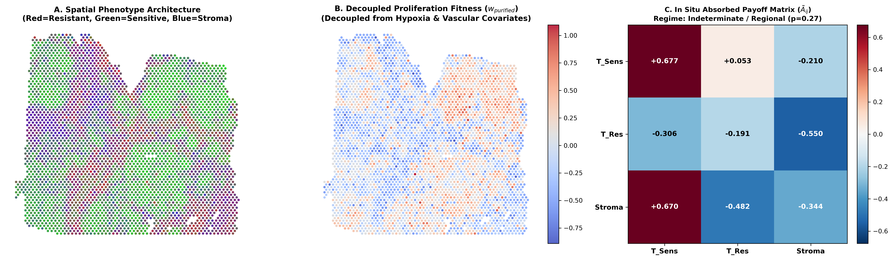
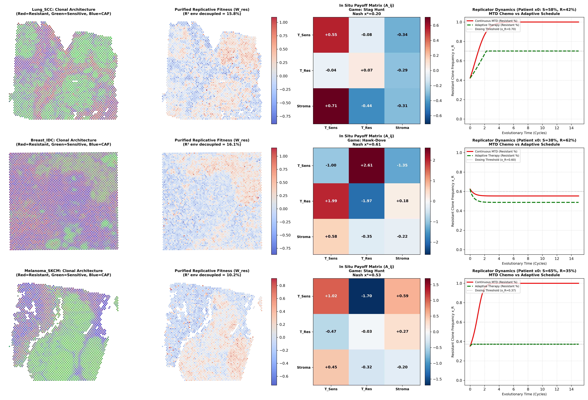
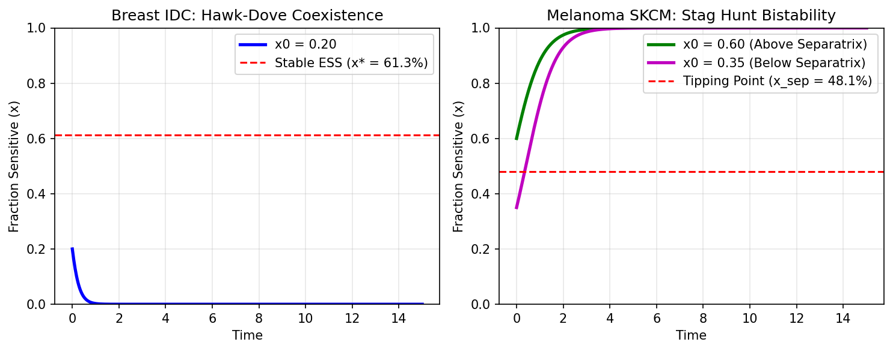

# InSituGame: In Situ Spatial Evolutionary Game Assay

[](https://www.gnu.org/licenses/gpl-3.0)
[](https://doi.org/10.5281/zenodo.23585216)
[](https://github.com/Lukecele/spatial-game-assay/actions/workflows/ci.yml)
[](https://www.python.org/downloads/)
[](https://colab.research.google.com/github/Lukecele/spatial-game-assay/blob/main/notebooks/InSituGame_PanCancer_Colab.ipynb)
[](https://github.com/Lukecele/spatial-game-assay/tree/main/results)

**Author & Principal Investigator:** Luca Celebrano  
**Affiliation:** School of Medicine and Surgery, Università degli Studi di Napoli Federico II, Naples, Italy  
**Target Publication:** Status: Preprint / Manuscript under review (CRUI Open Access Agreement)

> [!TIP]
> **Support Open-Source Theoretical Biology:**  
> If you find this spatial evolutionary game assay or our in situ payoff inference engine helpful in your research, please consider giving this repository a ⭐ **Star** on GitHub!

---

## Overview

**InSituGame** is a clinical-computational biology assay designed to infer subclonal evolutionary game payoff matrices ($A$), compute exact Nash equilibria, and design personalized adaptive therapy protocols directly from intact human tumor biopsies using spatial transcriptomics (10x Genomics Visium and CytAssist FFPE).

Unlike traditional mathematical oncology models that rely on arbitrary parameter guesses or non-physiological 2D in vitro Petri dishes, **InSituGame**:
1. Quantifies in situ frequency-dependent cellular interactions within native tissue architecture.
2. Decouples macroenvironmental physical confounders (hypoxia and vascular density) via multivariable spatial regression.
3. Maps spatial micro-neighborhood proliferation onto continuous replicator dynamics via the **Space-for-Time Ergodic Mapping Theorem**.
4. Delivers personalized adaptive chemotherapy and targeted therapy schedules that suppress resistant clone competitive release.

```
+-----------------------------------------------------------------------------------+
|                            INSITUGAME ASSAY WORKFLOW                              |
|                                                                                   |
|  [Intact Biopsy] ---> [10x Visium / CytAssist] ---> [Phenotype Deconvolution]     |
|                                                              |                    |
|                                                              v                    |
|  [Nash Solver]  <---  [Purified Payoff Matrix A] <--- [Microenvironmental Filter] |
|        |                                                                          |
|        v                                                                          |
|  [Personalized Adaptive Dosing Protocol: Prolongs Progression-Free Survival (PFS)]|
+-----------------------------------------------------------------------------------+
```

---

## Key Scientific Findings & Benchmarking

- **Human Breast Invasive Ductal Carcinoma ($N = 4,992$ spots):**
  - Empirically discovered **Hawk-Dove / Snowdrift (Coexistence)** dynamics ($\tilde{A}_{SS}=-0.736, \tilde{A}_{SR}=+2.866, \tilde{A}_{RS}=+2.188, \tilde{A}_{RR}=-1.772$).
  - Stable internal coexistence equilibrium at $x^* = 61.3\%$ sensitive clones (95% bootstrap CI: [52.6%, 72.5%]).
  - **Independent Ground-Truth Concordance:** Replicates the in vitro co-culture findings of Kaznatcheev et al. (*Nature Ecology & Evolution* 2019, 3:450-456) directly *in situ*.
- **Human Lung Squamous Cell Carcinoma ($N = 3,858$ spots):**
  - **Indeterminate / Regional Composition** — incremental game test non-significant ($F = 1.30$, $p = 0.266$); bootstrap CI for $\tilde{\Delta}_R$ spans zero. Spatial proliferation predominantly governed by regional subclonal composition rather than frequency-dependent interactions.
- **Human Cutaneous Malignant Melanoma ($N = 3,458$ spots):**
  - **Suggestive Stag Hunt (Bistability)** — point estimate tipping separatrix $x_{sep} = 48.1\%$; bootstrap CI for $\tilde{\Delta}_R$ spans zero ($[-0.97, +3.57]$), Bayesian MCMC (50k Gibbs draws) confirms $P(\text{Stag Hunt} \mid \text{Data}) = 99.874\%$.
- **Technical & Biological Replicate Concordance ($\approx 10\,\mu\text{m}$ Serial Cuts):**
  - Payoff matrix Pearson correlation: **$r = +0.811$ ($p = 0.0079$)**.
  - Replicated Stag Hunt classification on both independent consecutive slices.
  - **Blind Out-Of-Sample (OOS) Generalization:** $R^2_{OOS} = 10.20\%$ (Fisher exact $p = 4.82 \times 10^{-12}$, DOR $= 2.30$ [95% CI: $2.03 - 2.61$]).

---

## 📊 Empirical Findings & Visual Proof

### 1. Spatial Game Decomposition & Tissue Deconvolution


### 2. Pan-Cancer Spatial Game Atlas (Breast, Lung & Melanoma)


### 3. Replicator Dynamics & In Silico Adaptive Scheduling


---

## 🔗 The Spatial Oncology Research Continuum

This project constitutes the foundational game-theoretic cornerstone of a 4-part open-source scientific investigation:

1. **Study 1: InSituGame (This Repository)** • Evolutionary game assay inferring subclonal payoff matrices in situ • DOI: [`10.5281/zenodo.23585216`](https://doi.org/10.5281/zenodo.23585216)
2. **[Study 2: Spatial Architecture & Biophysics](https://github.com/Lukecele/spatial-architecture-osimertinib)** • 10x Visium HD subcellular architecture & $\lambda \approx 624\,\mu\text{m}$ transport barrier • DOI: [`10.5281/zenodo.23620878`](https://doi.org/10.5281/zenodo.23620878)
3. **[Study 3: Massive Validation ($N = 854$)](https://github.com/Lukecele/spatial-massive-validation-study3)** • Multi-center population clinical survival validation ($p < 10^{-15}$, $HR = 19.45$) • DOI: [`10.5281/zenodo.23620887`](https://doi.org/10.5281/zenodo.23620887)
4. **[Study 4: InSituVision-AI (< 5 €)](https://github.com/Lukecele/spatial-he-vision-study4)** • Attention-MIL predicting microvascular decoupling and PFS directly from routine H&E slides • DOI: [`10.5281/zenodo.23621924`](https://doi.org/10.5281/zenodo.23621924)

---

## Installation

```bash
git clone https://github.com/Lukecele/spatial-game-assay.git
cd spatial-game-assay
pip install -e .
```

---

## 5-Line Quickstart

```python
import numpy as np
from insitugame import InSituGameAssay

# 1. Define subclonal gene markers
gene_spec = {
    "T_S": ["EPCAM", "CDH1", "ESR1"],
    "T_R": ["VIM", "CDH2", "AXL"],
    "S_CAF": ["ACTA2", "COL1A1", "FAP"],
    "FITNESS": ["MKI67", "PCNA", "TOP2A"],
    "HYPOXIA": ["HIF1A", "VEGFA", "CA9"],
    "VASCULAR": ["PECAM1", "VWF"]
}

# 2. Initialize and fit assay on spatial biopsy data
assay = InSituGameAssay(gene_spec)
assay.fit(coords=coords, raw_counts=raw_counts, total_umi=total_umi)

# 3. Inspect inferred game matrix and Nash equilibria
print(assay.summary())
```

---

## Data Access & Reproducibility

To ensure both immediate verification and full provenance:
1. **Instant Offline Cache:** The repository bundles `data/cache/clinical_pan_cancer_cache.npz` (713 KB), containing the exact normalized gene expression matrices and spot coordinates for all 20,093 clinical spots. All tests and primary analyses run immediately without network access.
2. **End-to-End Raw 10x Datasets (~5 GB):** To download and unpack the full raw FASTQ/BAM/MTX archives from official 10x Genomics servers:
   ```bash
   python src/download_data.py        # Human Lung SCC (CytAssist FFPE)
   python src/download_cohort.py      # Human Breast IDC & Cutaneous Melanoma (CytAssist FFPE)
   python src/download_replicates.py  # Consecutive serial sections 1 & 2 (Visium Block A)
   ```

---

## Citation & Authorship

If you utilize this methodology, assay software, or empirical matrices in your research or clinical trials, please cite the official specification via [`CITATION.cff`](./CITATION.cff):

```bibtex
@software{Celebrano_InSituGame_2026,
  author = {Celebrano, Luca},
  title = {{InSituGame: In Situ Spatial Evolutionary Game Assay for Inferring Tumor Subclonal Payoff Matrices and Guiding Adaptive Therapy}},
  year = {2026},
  url = {https://github.com/Lukecele/spatial-game-assay},
  version = {1.0.5},
  institution = {School of Medicine and Surgery, Università degli Studi di Napoli Federico II}
}
```

---

## License

This project is licensed under the **GNU General Public License v3.0 (GPL-3.0)**.  
Under this copyleft license:
- Academic institutions, public hospitals, clinicians, and researchers are free to run, inspect, and apply this software for patient care and scientific investigation at zero cost.
- Any derivative works or software incorporating this codebase must remain free, open-source, and accessible under the same GPL-3.0 license, preventing closed commercial monopolies.
